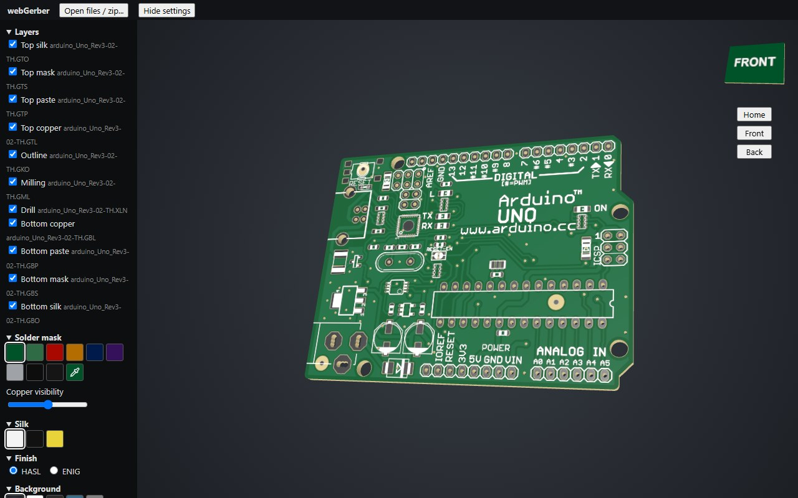

# webgerber

A 3D Gerber PCB viewer that runs entirely in the browser. Drop in a Gerber zip or files and inspect the board.

**[Open webGerber in your browser](https://hazarkarabay.github.io/webGerber/)**. You can try it with included open source example boards too.

## Thanks to

- [webGerber by Mayhew Labs](http://mayhewlabs.com/webGerber/), which inspired this project.
- [tracespace](https://github.com/tracespace/tracespace), whose [`@tracespace/plotter`](https://github.com/tracespace/tracespace/tree/v5/packages/plotter) and [`@tracespace/renderer`](https://github.com/tracespace/tracespace/tree/v5/packages/renderer) 5.0.0-alpha.0 (MIT) do the Gerber plotting. The fork in `vendor/tracespace/` has some adjustments and fixes for correct Gerber parsing and 3D generation.